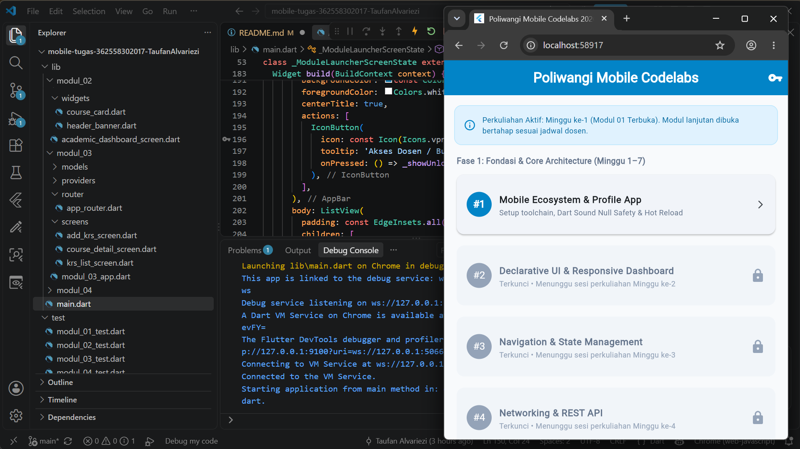
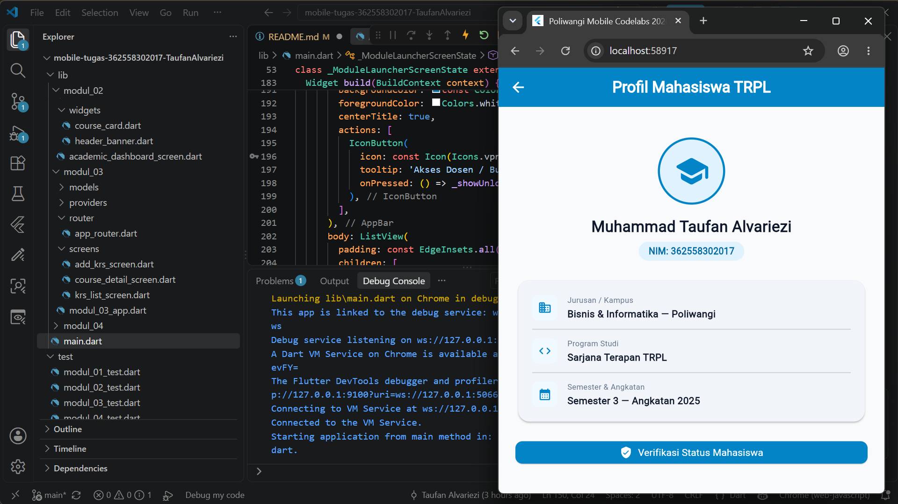

# Laporan Praktikum Modul 01: Mobile Ecosystem, Flutter Setup & Profile App

- **Nama Lengkap**: Zaky Arya Satya Danendra
- **NIM**: 362558302087
- **2D / Sarjana Terapan TRPL**: 3x / Sarjana Terapan TRPL
- **Pemrograman Perangkat Bergerak**: Pemrograman Perangkat Bergerak (Semester 3)

---

    ## 1. Ringkasan Aktivitas
    Pada minggu ini, saya mempelajari konsep dasar pengembangan aplikasi mobile menggunakan Flutter serta menyiapkan lingkungan pengembangannya (environment setup). Saya mempelajari bagaimana Flutter memanfaatkan struktur widget untuk membangun antarmuka pengembang (user interface), mulai dari StatelessWidget hingga StatefulWidget. Selain itu, saya juga mencoba membuat komponen UI dasar seperti Layout, Text, Image, dan Button untuk menyusun tampilan profil pengguna.

    ## 2. Bukti Tangkapan Layar (Running App)
    [Sertakan minimal 2 screenshot bukti aplikasi profil berjalan di emulator atau HP fisik Anda]

    
    

    ## 3. Kendala yang Dihadapi & Solusinya
    Kendala: Terjadi error Android SDK file not found atau cmdline-tools component is missing saat menjalankan perintah flutter doctor.

    Solusi: Membuka Android Studio, masuk ke menu SDK Manager > SDK Tools, lalu memberikan centang pada paket Android SDK Command-line Tools (latest) dan mengkliknya untuk menginstal. Setelah itu, saya menjalankan perintah flutter doctor --android-licenses untuk menyetujui lisensi SDK

    ## 4. Jawaban Pertanyaan Refleksi
    1. **Pilihan Native vs Flutter**: [Pilihan tergantung pada kebutuhan proyek. Flutter sangat unggul jika targetnya adalah efisiensi waktu dan biaya (multi-platform iOS dan Android dari satu basis kode) serta pembuatan prototype secara cepat. Sedangkan Native (Kotlin/Swift) lebih tepat dipilih jika aplikasi membutuhkan performa komputasi tingkat tinggi, akses penuh ke fitur spesifik perangkat keras/OS terkini, atau ukuran file APK/IPA yang seefisien mungkin.]
    2. **Prinsip UI = f(state)**: [Prinsip ini berarti bahwa antarmuka pengguna (UI) adalah hasil turunan atau fungsi (f) dari kondisi data terkini (state). Di Flutter, kita tidak merubah elemen UI secara manual satu per satu, melainkan merubah state datanya. Ketika state berubah, Flutter akan secara otomatis menggambar ulang (rebuild) widget yang terdampak untuk merefleksikan tampilan sesuai kondisi data terbaru tersebut.]
    3. **Pentingnya Conventional Commits**: [Penggunaan Conventional Commits penting untuk menjaga konsistensi dan kejelasan riwayat perubahan kode (commit history) dalam proyek pengembangan perangkat lunak. Format ini mempermudah kolaborasi tim dalam melacak bug, memahami konteks perubahan kode secara cepat (misal: feat: untuk fitur baru, fix: untuk perbaikan bug), serta memungkinkan pembuatan catatan rilis (changelog) secara otomatis.]
## Praktikum Fase B — Secure storage & pemulihan sesi

Kode Fase B ditambahkan secara terpisah di `lib/pengayaan/modul_06/`; implementasi Fase A di `lib/modul_06/` tetap dipertahankan.

### Menjalankan aplikasi Fase B

```bash
flutter pub get
flutter run
```

`lib/main.dart` menjalankan `Modul06PengayaanApp`. Pilih jenis penyimpanan melalui menu di kanan atas:

- **Memori**: sesi tidak bertahan setelah aplikasi dimulai ulang.
- **Prefs**: sesi disimpan melalui `shared_preferences`; papan diagnostik dapat mengembalikan token melalui API preferensi biasa.
- **Aman**: sesi disimpan melalui `flutter_secure_storage`; metode demo `bacaMentah` mengembalikan `null` karena plugin tidak menyediakan pembacaan mentah melalui kontrak ini.

Gunakan akun demo `student@trpl.test` dengan kata sandi `belajar123`. Papan diagnostik hanya menunjukkan kemampuan API aplikasi; ini bukan pemeriksaan forensik isi disk atau bukti keamanan perangkat produksi. Perlindungan secure storage bergantung pada platform dan konfigurasinya.

### Catatan dependensi

Fase B menggunakan `flutter_secure_storage` untuk adapter penyimpanan aman dan `shared_preferences` untuk demonstrasi pembanding preferensi biasa. Jika `flutter pub get` menampilkan masalah konfigurasi platform, ikuti pesan dari Flutter/plugin untuk platform yang sedang digunakan.
